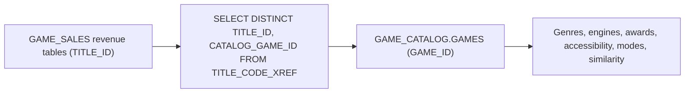

# Database design: CORTEX_SENSE_DEMO

Everything the demo creates lives in one database, `CORTEX_SENSE_DEMO`. `install/01-setup-db.sql` creates it; `install/02-load-data.sql` loads the two data schemas.

| Schema | Holds | Created by |
|---|---|---|
| `GAME_CATALOG` | Game attributes: 90 games with developer, publisher and franchise, plus genres, mechanics, modes, engines, platforms, monetization models, age ratings, awards, accessibility, narrative structures, studio acquisitions, game similarity and genre whitespace. 29 base tables, 2 dynamic tables, 7 views, 1 UDF, 3 procedures. | `02-load-data` |
| `GAME_SALES` | Commerce: 90 sales titles, digital products and transactions, hardware sales, subscriptions, customer accounts, and lifetime, monthly and quarterly revenue. Also the semantic view `SV_GAME_SALES` and the `GAME_SALES_DASHBOARD` Streamlit app. 14 base tables, 2 dynamic tables, 3 views. | `02`, `03`, `04` |
| `CONTEXTS` | The Cortex Sense context `GAME_ANALYTICS_CTX_V2` and the `KNOWLEDGE_BASE` stage (strategy memo, EU brief). | `01`, `06`, `07`, `08` |
| `AGENTS` | `GAME_AGENT_FINANCE`, `GAME_AGENT_ANALYST`, `GAME_AGENT_SENSE`. | `09` |
| `EVALS` | The eval source table and dataset, the `EVAL_CONFIG` stage, and `DEMO_AGENT_RESULTS` (refreshed by `scripts/build_web_data.py`). | `10`, `12`, step 13 |
| `PUBLIC` | `DATA_STAGE` and `PARQUET_FF` for the data load, `STREAMLIT_STAGE` for the dashboard source. | `01` |

## Two domains, built like two separate systems

The data imitates what most companies have: a **catalog** system that describes products and a **sales** system that records money, built by different teams. Each is complete and correct on its own. Neither knows the other's keys.

- **`GAME_CATALOG`** is keyed by `GAME_ID`. `GAMES` carries the descriptive columns (developer, publisher, franchise, release date), and the many-to-many tables (`GAME_GENRE_CLASSIFICATION`, `GAME_ENGINES`, `GAME_AWARDS`, `GAME_ACCESSIBILITY`, `GAME_MODES`, ...) hang off it.
- **`GAME_SALES`** is keyed by `TITLE_ID`. `TITLES` is the sales system's own list of the games it sells. All revenue tables use `TITLE_ID`:
  - `GAME_REVENUE`: lifetime digital income, one row per title (87 titles, about $19.23M).
  - `MONTHLY_REVENUE` and `QUARTERLY_REVENUE`: the same revenue over time, by monetization type.
  - `DIGITAL_PRODUCT_TRANSACTIONS`, `HARDWARE_SALES_TRANSACTIONS`, `SUBSCRIPTION_CHARGES`: the transaction facts behind the semantic view.

`SV_GAME_SALES` models only `GAME_SALES`. That is deliberate: it's the curated finance model most teams have, and it can't see the catalog.

## Duplicated data

Because each system keeps its own copy of the reference data, several tables exist in both schemas with the same rows but different keys or columns:

| Data | `GAME_CATALOG` | `GAME_SALES` | Difference |
|---|---|---|---|
| Games | `GAMES` (90, `GAME_ID`) | `TITLES` (90, `TITLE_ID`) | Different IDs. `TITLES` adds `STUDIO`, `PUBLISHER_LABEL` and a `YYYYMMDD` string `RELEASE_DATE`. |
| Platforms | `PLATFORMS` (20) | `PLATFORMS` (20) | Sales adds `PLATFORM_CODE` (PS2 to PS5). |
| Game platforms | `GAME_PLATFORMS` (153, by `GAME_ID`) | `GAME_PLATFORMS` (153, by `TITLE_ID`) | Same exclusivity data, different key. |
| Monetization models | `MONETIZATION_TYPES` (9) | `MONETIZATION_TYPES` (9) | Catalog adds `DESCRIPTION`. |
| Game monetization | `GAME_MONETIZATION` (129, by `GAME_ID`) | `GAME_MONETIZATION` (129, by `TITLE_ID`) | Different key. |

Names are spelled differently, too. The same publisher is `PUBLISHER_LABEL = 'SIE'` in sales and `PUBLISHER_NAME = 'Sony Interactive Entertainment'` in the catalog. Studios use spaces in `TITLES.STUDIO` ("Naughty Dog") and underscores in `GAMES.DEVELOPER_NAME` ("Naughty_Dog"). Joining on names silently drops rows; join on IDs.

## Joining across domains

The only reliable bridge is `GAME_SALES.TITLE_CODE_XREF`, the PlayStation Store title-code mapping. It has one row per title code (100 rows for 88 titles, since a title released on PS4 and PS5 has two codes), and each title maps to exactly one catalog game.



```sql
WITH title_map AS (
  SELECT DISTINCT TITLE_ID, CATALOG_GAME_ID FROM CORTEX_SENSE_DEMO.GAME_SALES.TITLE_CODE_XREF)
SELECT COALESCE(g.FRANCHISE_NAME, 'Unmapped') AS franchise, SUM(r.INCOME) AS revenue
FROM CORTEX_SENSE_DEMO.GAME_SALES.GAME_REVENUE r
LEFT JOIN title_map m ON m.TITLE_ID = r.TITLE_ID
LEFT JOIN CORTEX_SENSE_DEMO.GAME_CATALOG.GAMES g ON g.GAME_ID = m.CATALOG_GAME_ID
GROUP BY 1 ORDER BY 2 DESC;
```

The traps an agent without context falls into:

- **No `DISTINCT` on the xref.** Joining revenue to `TITLE_CODE_XREF` directly counts a multi-platform title once per code and inflates totals.
- **`TITLES.CATALOG_GAME_ID`.** It looks like the link but is NULL for 13 titles, so their revenue disappears.
- **Dropping unmapped titles.** Two titles (about $230K) have no catalog mapping. An inner join loses them; report them as `'Unmapped'` so totals still match `GAME_REVENUE`.
- **One-to-many attributes.** A game has about three fully matched genres (`MATCH_STATUS = 'FULL'`; `PARTIAL` and `NONE` rows aren't membership), so genre revenue totals overlap and must not be summed or read as shares. Monetization models and awards behave the same way.

These rules are recorded as Cortex Sense feedback rules (`scripts/record_feedback.py`), which is why only the Sense agent applies them consistently. More worked join paths: [sample-joinpaths.md](sample-joinpaths.md) and [title_code_xref.md](title_code_xref.md).

## Derived objects

| Object | Type | What it computes |
|---|---|---|
| `GAME_SALES.GAME_REVENUE` | Dynamic table | Lifetime digital income per title |
| `GAME_SALES.MONTHLY_REVENUE` | View | Monthly income per title and monetization type (`MONTHLY_INCOME`; `CUMULATIVE_INCOME` is a running total) |
| `GAME_SALES.QUARTERLY_REVENUE` | Dynamic table | Quarterly rollup of monthly revenue |
| `GAME_SALES.VW_PLATFORM_EXCLUSIVITY`, `VW_PLATFORM_REVENUE_SUMMARY` | Views | Exclusivity status and revenue by platform |
| `GAME_CATALOG.GAME_SIMILARITY_SCORES` | Dynamic table | Weighted audience overlap for every game pair, with `OVERLAP_TIER` |
| `GAME_CATALOG.GENRE_WHITESPACE_ANALYSIS` | Dynamic table | Genre combinations marked WHITESPACE, UNDERSERVED or SERVED |
| `GAME_CATALOG.VW_GAME_GENRE_ROLLUP`, `VW_GENRE_HIERARCHY` | Views | Genres rolled up to their parents |
| `GAME_CATALOG.VW_ACCESSIBILITY_GAPS`, `VW_CANNIBALIZATION_CANDIDATES`, `VW_GAME_OVERLAP_MATRIX`, `VW_GAME_PROFILE` | Views | Accessibility gaps, cannibalization pairs, overlap matrix, one-row game profile |

The dynamic tables refresh on `COMPUTE_WH` (set in their DDL under `sql/`). To use another warehouse, change it there too.
